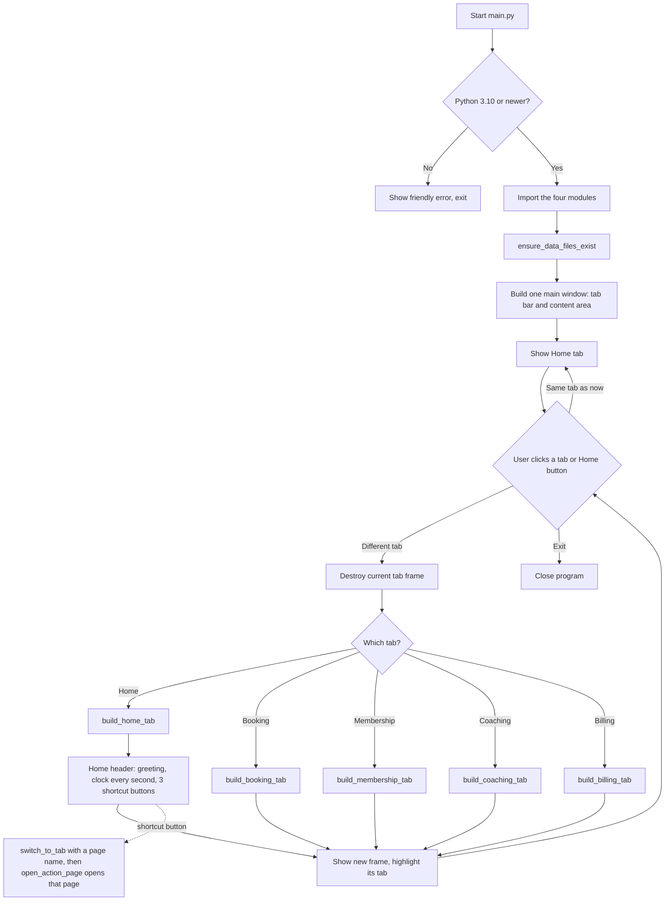
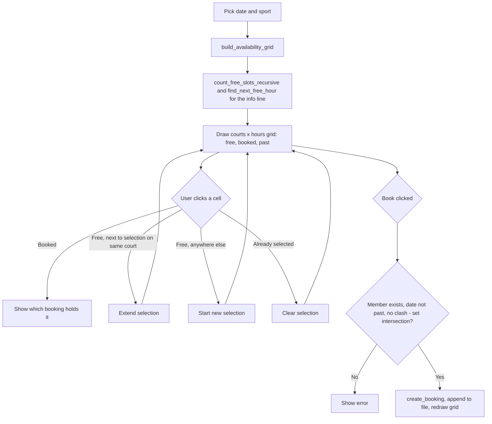
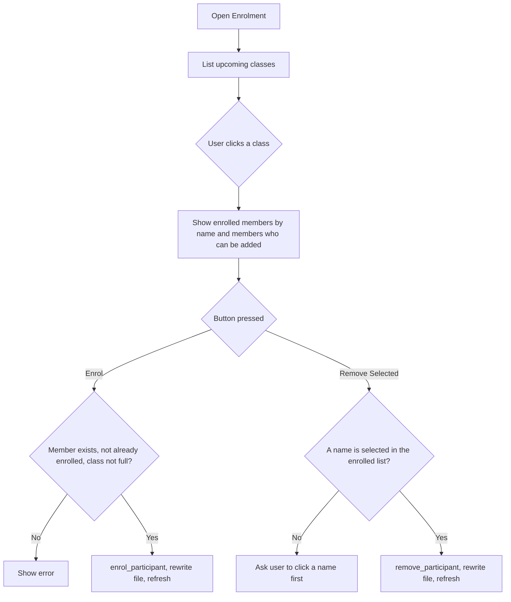

# Flowcharts and Stepwise Refinement

Updated after the simpler-tabs rewrite (Entry 16 in `AI_USAGE_LOG.md`)
to match the final code. All Mermaid blocks below were
checked for valid syntax (no unescaped brackets/quotes inside node text).

## Main program flow



## Booking module flow (Court Availability section)



## Coaching module flow (Enrolment section)



## Stepwise refinement (problem -> modules -> sub-tasks -> functions)

```
Problem: Manage a sports centre's bookings, members, coaching and billing.
|
|-- Module: Booking
|   |-- Sub-task: Show court availability per hour, per court, per sport
|   |   `-- build_availability_grid, count_free_slots_recursive, find_next_free_hour
|   |-- Sub-task: Book / cancel a booking (cancelled bookings are kept)
|   |   `-- create_booking, cancel_booking, has_clash
|   `-- Sub-task: Find bookings
|       `-- search_bookings
|
|-- Module: Membership
|   |-- Sub-task: Register for a membership type
|   |   `-- register_member, get_phone_set
|   |-- Sub-task: Update / renew / delete a member
|   |   `-- update_member, renew_member, delete_member
|   |   (delete checks both future bookings AND unpaid bills)
|   |-- Sub-task: Find members
|   |   `-- search_members, find_member_by_id
|   `-- Sub-task: Report on members
|       `-- count_members_by_type, members_expiring_within, count_members_recursive
|
|-- Module: Coaching
|   |-- Sub-task: Manage coaches
|   |   `-- register_coach, update_coach (moves upcoming classes to a new sport),
|   |       delete_coach (blocked while classes remain), find_coach_by_id
|   |-- Sub-task: Assign coaches to private sessions / group classes
|   |   `-- schedule_class, update_class, cancel_class, validate_class_details
|   |-- Sub-task: Manage participants
|   |   `-- enrol_participant, remove_participant, load_member_names
|   `-- Sub-task: Track working hours and commission
|       `-- coach_hours_by_month, calculate_commission, total_commission_recursive
|
`-- Module: Billing
    |-- Sub-task: Create a bill
    |   `-- generate_bill, billed_references, unbilled_bookings, unbilled_classes
    |-- Sub-task: Take payment
    |   `-- pay_bill, write_receipt, read_receipt, find_bill_by_id
    |-- Sub-task: Manage bill status
    |   `-- void_bill, delete_void_bill, search_bills
    `-- Sub-task: Daily revenue by category (court, coaching, retail, membership)
        `-- daily_revenue_summary (PAID bills only), total_bills_recursive
```
